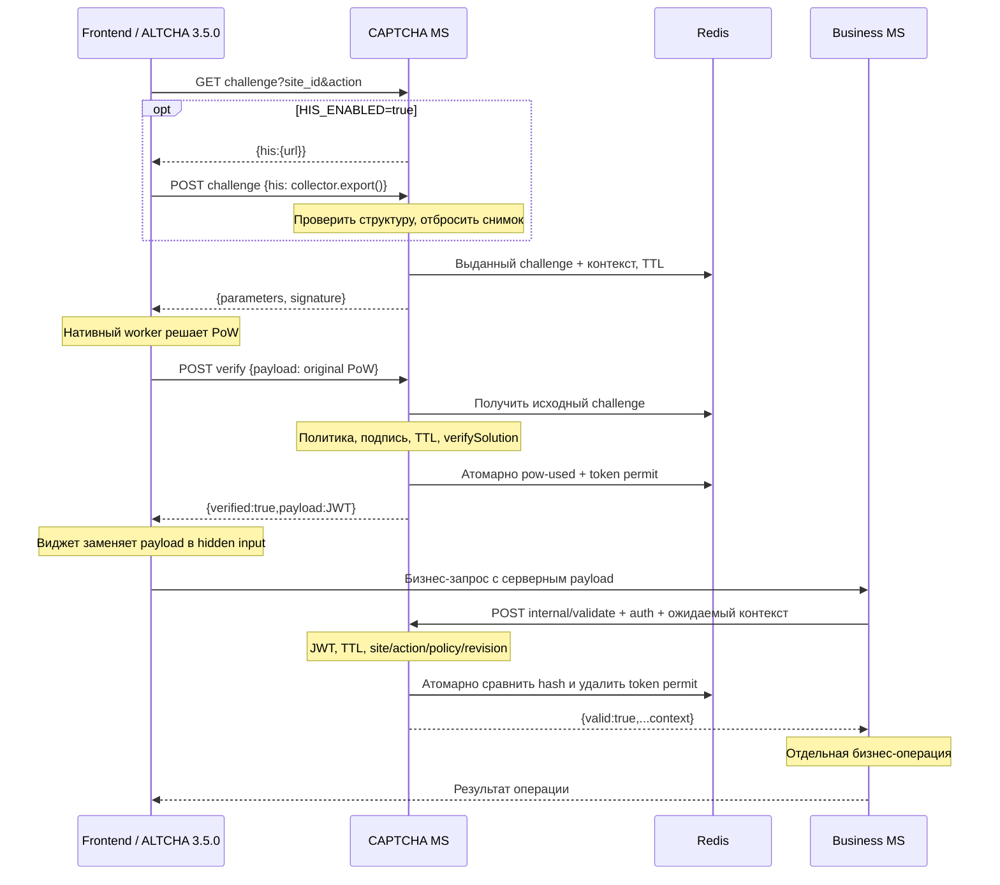

# Архитектура и назначение ветки

`altcha-native-backend` создана от чистой `main`, коммит `9033596` (`Initial ALTCHA PoC backend`). Это альтернативная реализация, рассчитанная на штатный протокол ALTCHA Widget 3.5.0. Исходные маршруты, сессии и mock-сценарии доступны в `main`; ветки не объединялись и их история не переписывалась.

## Полный поток



## Компоненты и библиотеки

| Компонент | Назначение |
| --- | --- |
| `src/config.ts` | Серверная регистрация сайтов, действий, политик, ключей и сервисных scopes |
| `src/service.ts` | `altcha-lib@2.8.0`: createChallenge/verifySolution + PBKDF2 из node:crypto; `jose@6.2.14`: HS256 JWT |
| `src/store.ts` | `redis@6.3.1`: issued challenges, отдельное PoW-состояние, token permits, shared rate limit |
| `src/app.ts` | `fastify@5.12.7`, `@fastify/cors@11.3.1`: HTTP API, schema validation, CORS, auth, безопасные ошибки |
| `src/his.ts` | Строгий парсер опубликованной структуры collector 3.5.0 |
| `src/server.ts` | `dotenv@18.0.8`, явная конфигурация, запуск/остановка |
| `examples/` | Отдельный Business MS, статический frontend и настоящий `altcha@3.5.0` |
| `test/` | Node test runner/tsx; Playwright 1.64.1 или тот же harness в интерактивном браузере |

Криптографические примитивы не реализуются вручную. Подпись challenge и PoW — библиотека ALTCHA, PBKDF2 и SHA-256 — Node crypto, подпись/проверка JWT — jose. Сравнение Bearer secrets использует `timingSafeEqual` над фиксированной длиной SHA-256.

## Серверные политики

`SITES_JSON` содержит site → defaultAction/actions/origins. `POLICIES_JSON` необязателен и при указании заменяет весь набор профилей. Default:

| Профиль | PBKDF2 iterations/попытку | Диапазон случайного counter | Challenge TTL | Token TTL |
| --- | --- | --- | --- | --- |
| standard | 5000 | 200–400 включительно | 120 s | 60 s |
| strict | 10000 | 400–800 включительно | 120 s | 45 s |

```json
{
  "standard": {"cost":5000,"counterMin":200,"counterMax":400,"challengeTtl":120,"tokenTtl":60},
  "strict": {"cost":10000,"counterMin":400,"counterMax":800,"challengeTtl":120,"tokenTtl":45}
}
```

Библиотека вычисляет keyPrefix по случайно выбранному counter. Клиент не получает сам counter; solver перебирает значения. Генерация и проверка требуют по одному PBKDF2, решение — перебора. Значения по умолчанию требуют измерений на целевых устройствах и настройки под нагрузку; это не сертифицированный уровень защиты от автоматизации.

Клиент не может понизить политику query-параметром. Challenge и JWT подписывают site/action/policy и SHA-256 ревизии параметров политики (`cost`, counter bounds, TTLs, graphics). Изменение профиля под прежним именем делает старые challenge/tokens непригодными. Конфигурация фиксирована на время процесса; для обновления нужен согласованный перезапуск реплик.

`graphics:true` зарезервирован как серверная возможность, но останавливает запуск с `GRAPHICS_UNSUPPORTED`. Он не включает несуществующую проверку. Для разработки графического backend нужен отдельный архитектурный выбор.

Сервер не выдаёт `configuration` и `X-Altcha-Config`; allowlist таких переопределений в этой реализации **пустой**. Входные query/body не могут повлиять на `fetch`, verify URL или другие настройки виджета.

## Состояние и одноразовость

Все реплики используют один namespace и один Redis dataset. Ключи содержат hash tag namespace; текущий клиент подключается к одному Redis endpoint, полноценный Cluster/Sentinel discovery не реализован.

| Ключ | Содержимое | Срок хранения |
| --- | --- | --- |
| `challenge:<uuid>` | Исходный challenge, контекст, `hisReceived` | До expiresAt, по умолчанию 120 s |
| `pow-used:<uuid>` | Маркер `1` | Остаток TTL исходного challenge |
| `token:<jti>` | SHA-256 полного подписанного токена | До JWT exp, по умолчанию 60 s |
| `rate:<sha256(ip)>` | Счётчик запросов | 60 s от первого запроса |

Префикс: `captcha:{native-v1}:`. Значения challenge не содержат решение, снимок HIS или клиентские form fields. Redis не хранит raw JWT. PoW и token имеют независимые идентификаторы и состояния.

После проверки PoW JWT сначала подписывается в памяти. Один Lua-вызов проверяет существование/остаточный TTL challenge и отсутствие `pow-used`, записывает `pow-used` и разрешение для нового `jti`. Конкуренты получают только один выданный токен. Внутренняя проверка другим Lua-вызовом сравнивает hash и удаляет permit. Подпись без permit не даёт успеха.

При недоступности Redis, исчерпании памяти, таймауте команды, истечении TTL или потере состояния сервис отказывает. Нет fallback в Map, пропуска ошибок или успешного ответа по одной подписи. Команды ограничены 2 s; offline queue выключена. Клиент намеренно не переподключается автоматически: после разрыва сервис остаётся fail-closed до supervised restart.

Compose использует persistent volume, AOF `appendfsync always` и `noeviction`. Это локальный single-primary пример, не HA-кластер. Удаление/откат dataset, ручное удаление маркеров или несогласованный failover могут нарушить гарантии уже погашенных состояний. После восстановления старого snapshot/failover без доказанной сохранности записей остановите выдачу/проверку минимум на максимальный challenge TTL (600 s), дождитесь истечения всех прежних challenge/tokens и только затем возобновляйте работу; при необходимости смените signing keys. Репликация Redis сама по себе не доказывает линейризуемость и durable exactly-once.

## Ключи и сервисная аутентификация

- Независимые `CHALLENGE_KEYS_JSON` и `TOKEN_KEYS_JSON`: `{active,keys}`. Значения — секреты от 32 bytes; setup генерирует 32 случайных bytes как hex. Общий секрет двух назначений запрещён.
- Challenge kid входит в подписанные data. JWT kid находится в защищённом header. Старые ключи используются только при проверке, новые выдачи используют active.
- Ротация: сначала распространить новый verification key на все реплики, затем согласованно переключить active, сохранить старый challenge key не меньше максимального challenge TTL после последней выдачи и старый token key не меньше максимального token TTL. После этого убрать старые ключи. Несогласованные реплики могут отклонять новые payload, поэтому rollout должен учитывать обе фазы.
- `INTERNAL_CLIENTS_JSON`: независимые Bearer secrets, allowlist sites. Для ротации сервисного секрета временно добавьте второй client с новым secret и теми же site scopes, переведите Business MS, удалите старый client.
- Production secrets — из secret manager/environment, не из Git. JWT не зашифрован: claims являются публичным контекстом, в них нет PII/секретов.
- Внутренний путь зарегистрирован на HTTP listener, но защищён обязательной auth. В deployment ingress должен исключать `/internal/*` из публичного доступа и разрешать его только доверенной backend-сети. mTLS, ingress manifests и конкретный secret manager остаются инфраструктурным решением.

## CORS, лимиты, логи и приватность

CORS разрешает только точные origins зарегистрированных сайтов, методы GET/POST/OPTIONS и Content-Type. На challenge и verify дополнительно проверяется origin конкретного сайта, а не только общий CORS список. Отсутствие Origin допускается для API/небраузерных клиентов; Origin не считается аутентификацией и не защищает от произвольного HTTP-клиента.

Общий лимит: 120 запросов/IP/60 s, общий для реплик через Redis. OPTIONS и readiness не расходуют квоту. `trustProxy=false`: произвольный X-Forwarded-For не меняет ключ. За reverse proxy нужен отдельно настроенный trusted proxy/edge rate limiting; иначе все посетители за proxy/NAT делят лимит. SHA-256 IP — псевдонимизация краткоживущего ключа, не обещание необратимой анонимности.

Request logging выключен. Обработчик неожиданных ошибок пишет только event и имя класса ошибки. Authorization, payload, body, Redis URL, signing keys и HIS не логируются. Объём тела — 32 KiB, PoW payload — 16 KiB, JWT на внутреннем API — 8 KiB, socket/request timeout — 10 s. Production gateway должен дополнительно ограничивать соединения и общую нагрузку.

Raw HIS живёт только в памяти обработки одного POST и сразу отбрасывается. Пустые массивы разрешены; каждый канал ограничен 60 строками, типы/ширины/числовые диапазоны проверяются. Сохраняется лишь `his_received` на TTL challenge/token. Нет персистентной телеметрии, user tracking, behavioural score или client identity. Если HIS не нужен, оставьте backend flag выключенным и отключите collector на frontend до mount.

## Ограничения и оставшиеся решения

1. Только modern PBKDF2/SHA-256; legacy PoW v1, Argon2/Scrypt и протокол Sentinel server-signature не включены. JWT — контракт собственного CAPTCHA MS, принимаемый виджетом как opaque payload.
2. Нет генерации графики/аудио, visual puzzle, HIS-аналитики, threat intelligence или адаптивного risk scoring. Наличие HIS не доказывает человечность.
3. CAPTCHA не является аутентификацией/авторизацией пользователя и не привязывает payload к конкретному browser/session или содержимому формы. Привязка — site/action/policy. Для business fields binding потребуется отдельное решение.
4. Погашение токена и бизнес-транзакция не атомарны друг с другом. Если Business MS упал после validate, токен уже использован; нужна собственная идемпотентность/транзакционная модель Business MS. Не заявляется exactly-once бизнес-операция.
5. TLS/mTLS, HA/durability/failover fencing Redis, ingress ACL, secret manager, метрики без payload и нагрузочное тестирование должны быть определены при deployment.
6. Проверены текущие Node и Chromium; mobile, assistive technologies и остальные browser engines требуют отдельной матрицы. Пример Business MS не содержит реального бизнес-хранилища.

## Отличия от main

| Аспект | main, 9033596 | altcha-native-backend |
| --- | --- | --- |
| ALTCHA library | 2.7.0 | 2.8.0, exact lockfile |
| Основной API | Сессия, обязательный HIS POST; отдельные MS envelopes | Нативный GET, optional HIS handshake, корневой modern challenge |
| Frontend | Исследовательские адаптеры для MS-контракта | Только challenge/verifyUrl и hidden field виджета |
| Проверка | Исходный payload и in-memory records | JWT после public verification, отдельное внутреннее consume API |
| Состояние | Maps процесса | Redis TTL/Lua, гонки между репликами проверяются |
| Контекст | Экспериментальный контракт | Server site/action policy map, signed revision, internal expected context |
| Keys/auth | Один HMAC secret, mock-вызовы | Независимые key rings, service auth/scopes, HTTP Business MS |
| Graphics | Собственная canvas CAPTCHA | Удалена из альтернативного решения; библиотечный предел явно описан |
| HIS | Сбор и серверный разбор | Опциональный нативный handshake, строгая структура, отсутствие анализа зафиксировано |
| Окружение | .env | Отдельный .env.native; прежний файл сохранён |
| Тесты | Серверный PoC, браузер в соседнем frontend | Самостоятельные Redis/API и real-widget browser harness в этом репозитории |
